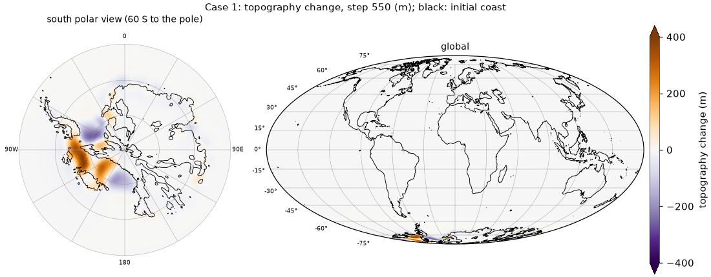
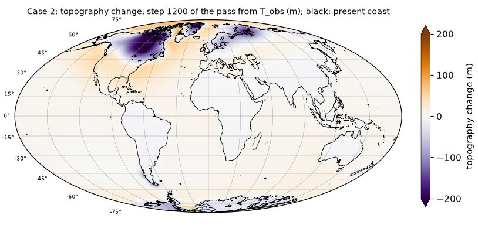
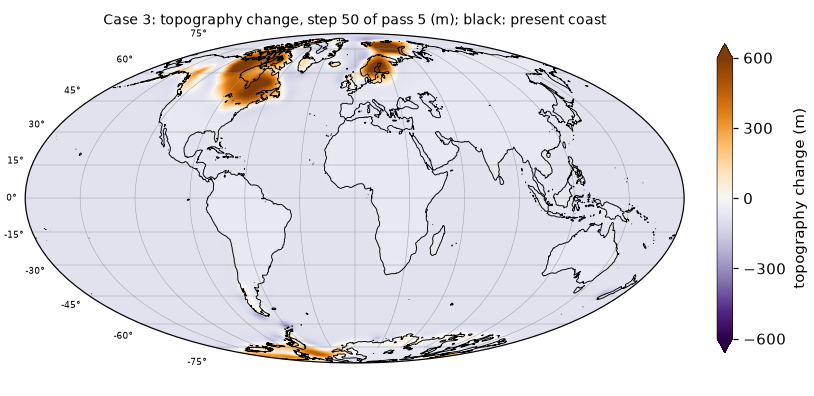
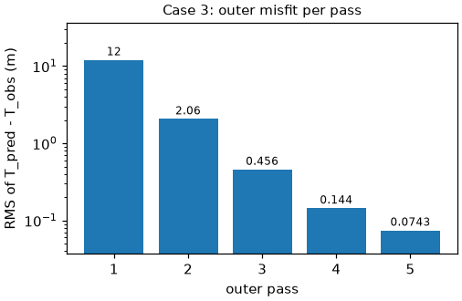

# Running the benchmark cases

This page gives the input preparation and run commands of the three benchmark cases for both solvers.

Data provenance, the corrupt Earth-model file of Case 2 and the total-versus-grounded ice issue of
Case 1 are documented in [Benchmark provenance](provenance.md). The scripts in `examples/` contain the
commands below; each takes the prepared `INPUT_FILES` directory from the environment variable `INPUT`
and the thread count from `THREADS` (default 8), builds the Fortran executable with the matching `CASE`
preset (into `fortran/build/<case>/`) and runs in the current directory. The Fortran build uses the
active toolchain ([Installation](install.md#fortran)); set `CONDA_ENV=slevolve-fortran` instead of
activating it, if you prefer. The Python commands need the Python environment of the same page.

**Summary** (wall times of the Python reference runs on an Apple M4 Max with 8 threads):

| case | run | Python wall time | memory and disk |
|---|---|---|---|
| 1 | forward run, 550 x 1 yr | 20 s | 2.2 GB of ice input (`.bin`); every output field is 4 MB per step, so restrict the steps (`SLEVOLVE_SNAP`) or fields (`--save-fields`) |
| 2 | one outer pass, 1200 x 200 yr | 38 s | ice cache of about 5 GB in `python/cache/` (Python) |
| 3 | first-pass topography 13 s + 5 outer passes 18 s | 31 s | 0.5 GB of ice input (text) |

## Case 1: Antarctic forward run (550 × 1 yr)

**Data** (about 9 GB to download):

* Dryad, Yousefi et al. (2022), doi:10.5061/dryad.ncjsxkswm: `fort.92_85_MISI.nc.xz` (8.9 GB;
  decompress with `xz -d`), the ice thickness of the ice-sheet run.
* OSF, Han et al. (2022), doi:10.17605/OSF.IO/8PTFM, folder `Data/AIS_550yr/`:
  `INPUT_AIS history.zip` (127 MB; the archived grounded-ice files `AISload_gd_Run85_0_0_0` ..
  `_550`; unzip it with `unzip "INPUT_AIS history.zip"`, quoting the name because of the space), `INPUT_Others/prem_512.l60K2C.sum18p6.dum19p2.tz19p4.lm22` (also shipped in `lovenum/`),
  and from `OUTPUTS_StandardSimulations.zip` (2.0 GB) only the member
  `OUTPUTS_StandardSimulations/dt=1yr/topo0` (`unzip -j OUTPUTS_StandardSimulations.zip
  'OUTPUTS_StandardSimulations/dt=1yr/topo0'`), saved as `topo0_archive`.

**Input tree** (`/path/to/INPUT_FILES`)

* `icemodel/AISload_gd_Run85_0_0_<k>.bin`, k = 0..550: the total ice, built with

  ```bash
  python3 tools/build_case1_total_ice.py --nc /path/to/fort.92_85_MISI.nc \
      --grounded /path/to/grounded_bin --out /path/to/case1
  # -> /path/to/case1/total/icemodel/  (and totalY/, a pure resampling used as a control)
  ```

  `--grounded` is a directory with the archived grounded-ice files of the OSF archive converted to
  `.bin`, either with the Fortran tool built next to every executable
  (`fortran/build/case1/make_cache 512 OUTDIR FILE...`) or, without a Fortran build, with Python:
  `python python/tools/text2npy.py --dir GROUNDED_TEXT --pattern 'AISload_gd_Run85_0_0_*' --outdir OUTDIR`
  followed by `python -c "import glob, numpy as np; [np.load(f).astype('<f8').tofile(f[:-4] + '.bin') for f in glob.glob('OUTDIR/*.npy')]"`
  (the `.bin` payload equals the `.npy` payload). Despite the `_gd_` prefix, the files in
  `total/icemodel/` hold the total ice.
* `earthmodel/prem_512.l60K2C.sum18p6.dum19p2.tz19p4.lm22`: the Love-number file distributed with
  Han et al. (2022), included unchanged in `lovenum/`. `examples/case1_forward.sh` copies it there if
  it is missing.
* `grid/GLlat_512.txt`, `grid/GLlon_512.txt` (written by `tools/make_grid.py` if missing).
* `others/topo0_archive` (text; optionally converted with
  `python3 python/tools/text2npy.py /path/to/INPUT_FILES/others/topo0_archive`).

**Run**

```bash
INPUT=/path/to/INPUT_FILES bash examples/case1_forward.sh fortran
INPUT=/path/to/INPUT_FILES bash examples/case1_forward.sh python
```

The Fortran branch is equivalent to

```bash
CASE=case1 bash fortran/build.sh
mkdir -p RUN_case1/OUTPUT_SLM RUN_case1/ICELOAD_SLM
ln -sfn /path/to/INPUT_FILES RUN_case1/INPUT_FILES
cp fortran/build/case1/exe RUN_case1/ && cd RUN_case1
OMP_NUM_THREADS=8 OMP_STACKSIZE=32M SLEVOLVE_INNER=extrap \
SLEVOLVE_SNAP=550 SLEVOLVE_SNAP_FIELDS=tgrid ./exe 550
```

and the Python branch to

```bash
python3 python/run_ais.py --steps 550 --threads 8 --sht ducc --lmax 511 --opt all --inner extrap \
    --icedir /path/to/INPUT_FILES/icemodel \
    --topo /path/to/INPUT_FILES/others/topo0_archive \
    --earth /path/to/INPUT_FILES/earthmodel/prem_512.l60K2C.sum18p6.dum19p2.tz19p4.lm22 \
    --save-fields tgrid,ocean --out OUT_case1_py
```

Check either output against the shipped reference:

```bash
python tests/check_reference.py --case case1 --dir OUT_case1_py              # Python
python tests/check_reference.py --case case1 --dir RUN_case1/OUTPUT_SLM      # Fortran
```

The Fortran example writes only `tgrid0` and `tgrid550`, so for it `check_reference.py` compares
`dtopo_550` and the inner-iteration counts (from the text file `OUTPUT_SLM/numiter`), reports the
other reference fields as `SKIP` and lists them at the end. For the Fortran example output it
reported `dtopo_550` max |diff| 8.2e-12 m and identical iteration counts (2099). To compare all
fields, run the Fortran example with `SLEVOLVE_SNAP=1,100,550 SLEVOLVE_SNAP_FIELDS=tgrid,ocean`.

**Expected result.** Topography change at step 550 (`reference/case1/dtopo_550.npy`, south polar
stereographic view and global Mollweide view; colormap PuOr_r with fixed limits +-400 m as in
Fig. 3a of the paper, arrows on the colour bar for values beyond; maximum 390 m; black line: coast of
the initial topography):



The unloading of the West Antarctic ice sheet raises the bed by up to 390 m after 550 years on this
low-viscosity Earth, with subsidence where ice thickens. Area-weighted RMS 12.3 m; 2099 inner
iterations in 550 steps.

**Variants**

* **Legacy-equivalent run** (exact, comparable to the legacy solver): the same with `SLEVOLVE_INNER=off`
  (Python: `--inner off`).
* **All snapshots**: omit `SLEVOLVE_SNAP` (or set `SLEVOLVE_SNAP=all`).

## Case 2: two glacial cycles (1200 × 0.2 kyr), one pass

**Data** (about 640 MB): OSF, Han et al. (2022), doi:10.17605/OSF.IO/8PTFM:
`Data/SeaLevelModel_TwoGlacialCycle_Simulations/INPUT_NHIS2GC.zip` (630 MB; `iceload0` ..
`iceload1200`) and `Data/CoupledModel_OneGlacialCycle_Simulations/INPUT_Others/etopo2_512_ice6gC`
(8.4 MB). The Love numbers are shipped (`lovenum/prem_512.l120C.ump5.lm5`).

**Input tree**

```bash
bash tools/prepare_case2_inputs.sh ICEDIR TOPO EARTH GRIDDIR /path/to/INPUT_FILES
```

* `ICEDIR`: `iceload0..iceload1200` extracted unchanged from `INPUT_NHIS2GC.zip` (OSF archive).
* `TOPO`: `etopo2_512_ice6gC` (OSF archive).
* `EARTH`: the Love-number file for the Case 2 Earth model, `lovenum/prem_512.l120C.ump5.lm5` (the
  archived file is corrupt; see [Benchmark provenance](provenance.md)). The `case2` preset compiles in this
  `PLANETMODEL` name; rebuild with `PLANETMODEL=<your file name>` to use another file.
* `GRIDDIR`: directory with `GLlat_512.txt` and `GLlon_512.txt` (written by `tools/make_grid.py` if
  they are missing).
* The script needs `make_cache`: build first with `fortran/build.sh` (e.g. `CASE=case2`), or set `MAKE_CACHE`.

**Settings** (`CASE=case2`): `L_sim = 240000`, `dt1..4 = 200`, `norder = 511`,
`initial_topo = .false.`, `topomodel = etopo2_512_ice6gC`, driver `run_outer_plus`.

**Run** (first outer pass from the present topography):

```bash
INPUT=/path/to/INPUT_FILES bash examples/case2_one_pass.sh fortran
INPUT=/path/to/INPUT_FILES bash examples/case2_one_pass.sh python
```

The Fortran branch builds with `CASE=case2`, sets up `RUN_case2/` and runs
`OMP_NUM_THREADS=8 OMP_STACKSIZE=32M SLEVOLVE_INNER=extrap ./exe 1200 1`. The Python branch runs

```bash
python3 python/run_outer.py --iters 1 --inner extrap --opt all --lmax 511 --threads 8 \
    --inputs /path/to/INPUT_FILES --icepfx iceload --nfiles 1201 --dt 200 \
    --topo-pres /path/to/INPUT_FILES/others/etopo2_512_ice6gC \
    --earth /path/to/INPUT_FILES/earthmodel/prem_512.l120C.ump5.lm5 --save-steps 1,600,1200 --out OUT_case2_py
python tests/check_reference.py --case case2 --dir OUT_case2_py
```

The paper reports this case as one pass only.

**Expected result.** Topography change at step 1200 of the pass from the present topography
(`reference/case2/dtopo_1200.npy`, Mollweide view; colormap PuOr_r with fixed limits +-200 m, the
99th percentile of |change| (173 m) rounded up, arrows on the colour bar for values beyond; maximum
283 m; black line: present coast):



The largest changes are under the former North American and Eurasian ice sheets. Area-weighted RMS
27.4 m, which is also the outer misfit of this pass (`reference/case2.json`, `misfit_rms`).

## Case 3: ICE-NADI-1 (50 × 0.5 kyr), full outer iteration

**Data**: Zenodo, Lucas et al. (2026), doi:10.5281/zenodo.21464139: `ICE-NADI-1.nc`; and from the
OSF archive of Case 2 the present topography `etopo2_512_ice6gC` (8.4 MB). The Love numbers are
shipped (`lovenum/prem_512.l96C.ump3.lm1`).

**Input tree**

```bash
python3 tools/prepare_case3_nadi.py --out /path/to/INPUT_FILES --ice-nc /path/to/ICE-NADI-1.nc \
    --grid /path/to/grid --topo /path/to/etopo2_512_ice6gC   # --grid optional (make_grid.py)
mkdir -p /path/to/INPUT_FILES/earthmodel
cp lovenum/prem_512.l96C.ump3.lm1 /path/to/INPUT_FILES/earthmodel/
```

This writes `icemodel/nadi_0..50`, `others/topo_pres`, `grid/`. Store the ICE-NADI-1 ice as `<f8`:
it is not f4-lossless ([File formats](formats.md) §4).

**Run**

```bash
INPUT=/path/to/INPUT_FILES bash examples/case3_ice_age.sh fortran 5   # 5 outer passes
INPUT=/path/to/INPUT_FILES bash examples/case3_ice_age.sh python 5
```

The script first builds the segmented, partially relaxed initial topography (skipped if
`T0_segmented.npy` exists in the current directory):

```bash
python3 python/init_topo_segmented.py --inputs /path/to/INPUT_FILES --icepfx nadi_ --nfiles 51 \
    --dt 500 --earth /path/to/INPUT_FILES/earthmodel/prem_512.l96C.ump3.lm1 --lmax 511 \
    --out T0_segmented.npy
```

`--dt` is the step length in **years** (500), as for `run_outer.py`; the script converts it to kyr
internally and prints both. The fixed point starts from the present topography unless `--start` is
given; a `.json` file with the segments is written next to the output.

*Fortran* (in-process outer driver): the script builds with `CASE=case3` and calls

```bash
OMP_NUM_THREADS=8 OMP_STACKSIZE=32M SLEVOLVE_INNER=extrap SLEVOLVE_REUSE=warm INPUT=/path/to/INPUT_FILES \
  bash examples/run_outer_mem.sh case3 case3 5 T0_segmented.npy
```

`examples/run_outer_mem.sh RUNNAME BUILDTAG NOUTER TOPO0 [LAST=50]` runs `fortran/build/BUILDTAG/exe`
in `./runs/RUNNAME`. With
`TOPO0=pres` it runs passes 1..NOUTER from the present topography. Otherwise it seeds
`tgrid0_1 = TOPO0` (`.npy`, `<f8`) and `pred_pres_topo_1` = the present topography, then runs passes
`2..NOUTER+1` in one process (`./exe LAST K0 K1`). The present topography is `TOPO_PRES=<path>`
(default `INPUT/others/topo_pres`, the Case 3 file): a `.npy` file (or `<path>.npy` when it exists) is
read directly, any other file as grid text with the build's `text2npy` (grid `NLAT` x `NLON`, default
512 x 1024). The wrapper needs no Python (bash, `od`, `awk`). The log is `run_mem.log`.

*Python*:

```bash
python3 python/run_outer.py --iters 5 --inner extrap --reuse warm --lmax 511 --threads 8 \
    --inputs /path/to/INPUT_FILES --earth /path/to/INPUT_FILES/earthmodel/prem_512.l96C.ump3.lm1 \
    --topo0 T0_segmented.npy --out OUT_case3_py
```

Check the result:

```bash
python tests/check_reference.py --case case3 --dir OUT_case3_py --topo-pres /path/to/INPUT_FILES/others/topo_pres
```

**Expected result.** Topography change at step 50 of pass 5 (`reference/case3/dtopo_p5_s50.npy`,
Mollweide view; colormap PuOr_r with fixed limits +-600 m, the 99th percentile of |change| (512 m)
rounded up, arrows on the colour bar for values beyond; maximum 1025 m; black line: present coast):



From 25 ka to the present the topography rises by up to about 1 km under the former North American
and Fennoscandian ice and falls by about 100 m over the oceans, the deglacial rise of sea level
relative to the sea floor.



The outer misfit, the area-weighted RMS of predicted minus observed present topography, falls from
12.0 m after pass 1 to 0.074 m after pass 5 (`reference/case3.json`, `misfit_rms`).

The figures of this page are made with
`python tools/plot_reference.py --outdir DIR --topo1 T1 --topo2 T2 --topo3 T3` from `reference/`,
where `T1`, `T2`, `T3` are the topographies whose 0 m contour is drawn as the coast (Case 1:
`INPUT_FILES/others/topo0_archive`; Case 2: `etopo2_512_ice6gC`; Case 3: `topo_pres`); how the runs correspond to the paper is in
[Reproducing the published results](reproduce.md).

**Next:** [Setting up a new case](own_case.md).
