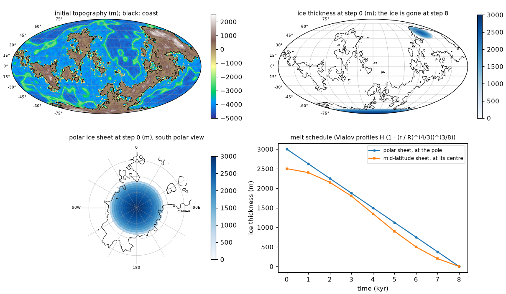
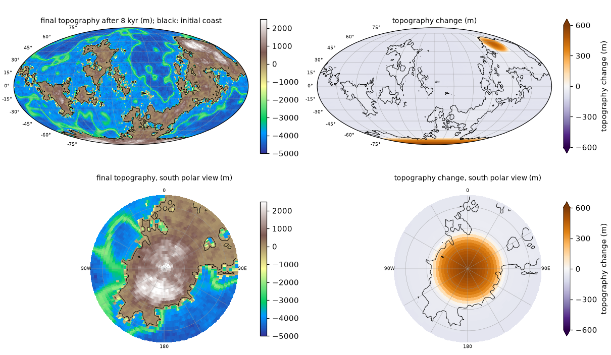
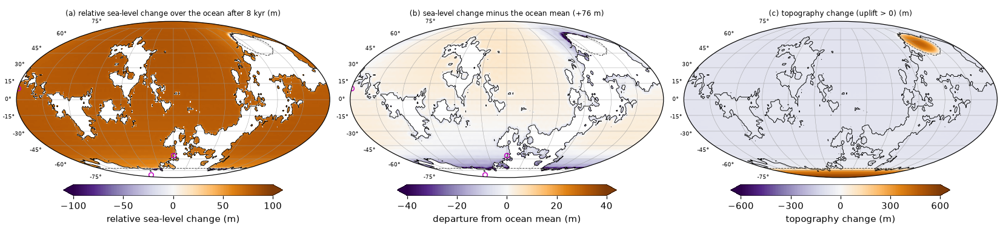
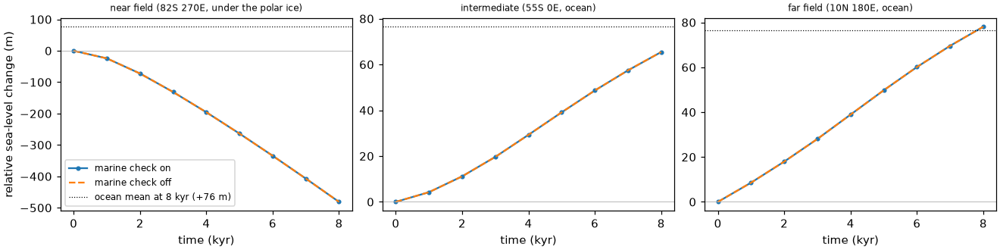

# Quick start

This page runs a small synthetic case with the **Python solver** in under a second and explains what
it prints and plots. The Fortran solver is checked on the same synthetic Earth at full resolution by
the [Fortran test](verify.md#fortran-test).

The sea-level equation gives the change of relative sea level, the height of the sea surface
(an equipotential of the gravity field) above the solid surface, caused by a change of the ice load,
including the deformation of a viscoelastic Earth, the perturbation of its gravity field and rotation,
and the redistribution of the meltwater over an ocean whose shoreline moves. SLEvolve solves it step
by step in time, with an inner iteration at every step on the ocean-load increment until the ocean
load, the deformation and the gravity field are mutually consistent.

## Run it

From the release root, in the Python environment of [Installation](install.md#python) (numpy is
enough; matplotlib for the figures; no ducc0, numba or benchmark data needed):

```bash
python examples/quickstart.py
```

**The synthetic Earth** (`tools/make_synthetic_case.py`, here on a 128 x 256 Gauss grid; the Fortran
tests use the same Earth on 512 x 1024, and `tools/make_synthetic_case.f90` writes identical files in
Fortran). An Earth-like random planet, the same in every run:

* **topography**: a Gaussian random field on the sphere, synthesised from random spherical-harmonic
  coefficients (fixed seed 20261013) for degrees 2 to 200 with a power-law spectrum (power per
  degree proportional to l^-2), plus two broad bumps that put land at the south pole and around
  60 N 130 E. A hypsometric transfer maps the field's area quantiles to Earth-like elevations:
  29 % land (+5 m at the coast, a few hundred metres inland, a tail to about 2.4 km), a continental
  shelf at -100 to -200 m over 3 % of the area, a continental slope, and an ocean floor mostly at -3700 to
  -4500 m (down to about -4800 m) with mid-ocean-ridge-like rises to about -2500 m. A second random field adds low-amplitude
  fractal detail. The result has continents of varied size with irregular coasts, archipelagos and
  shelves (top left of the figure below). The field is built once in Python with the shipped
  spherical-harmonic transform and shipped as `reference/synthetic/topography_seed.npy`
  (512 x 1024, whole millimetres), which both generators read, so the Python and Fortran
  generators write identical files; on other grids it is sampled at the nearest grid point;
* **ice**: two Vialov (equilibrium) profiles H = H0 (1 - (r / R)^(4/3))^(3/8), r the angular distance
  from the centre: a polar ice sheet on the south polar continent (centre at the pole, R = 17 degrees,
  H0 = 3000 m) and a mid-latitude ice sheet on the northern continent (centre 56 N 132 E,
  R = 12 degrees, H0 = 2500 m), both only where the initial topography is above -500 m (on land or
  shelf). The radii are chosen so that the ice lies on the land masses; a few cells at the margins
  are on the shelf, below sea level. Both melt to zero over 8 steps at fixed radius (the profile is
  scaled by the thickness at the centre), about 76 m of mean sea-level rise over the ocean in all:

| step | 0 | 1 | 2 | 3 | 4 | 5 | 6 | 7 | 8 |
|---|---|---|---|---|---|---|---|---|---|
| polar ice sheet at the pole (m) | 3000 | 2625 | 2250 | 1875 | 1500 | 1125 | 750 | 375 | 0 |
| mid-latitude ice sheet at its centre (m) | 2500 | 2400 | 2150 | 1800 | 1350 | 900 | 500 | 200 | 0 |

The quick start uses steps of 1 kyr so that the viscous response shows; maximum degree 63; Earth
model `lovenum/prem_512.l96C.ump3.lm1`; rotational feedback and the marine (flotation) check on. The
script also runs the same case with the marine check off for comparison. `--topography FILE` of
`make_synthetic_case.py` replaces the synthetic topography by a real bedrock grid ((N, 2N) `.npy`);
it is not used here.

All maps on this page are drawn with `python/tools/plot_fields.py`: a global Mollweide view
(longitude -180 to 180) and a south polar stereographic view (0 E at the top); the black line on every
map is the coast of the initial topography (its 0 m contour). Changes are drawn with the diverging
colormap PuOr_r of the paper's topography-change panels, with symmetric limits fixed per figure
(here the 99th percentile of |change| rounded up to a nice number) and arrows on the colour bar for
values beyond the limits.



Top left: initial topography. Top right: ice thickness at step 0 (the mid-latitude sheet is in the
upper right, on the northern continent). Bottom left: the polar ice sheet at step 0 in the south
polar view (circles 10 degrees apart). Bottom right: the melt schedule. At step 8 both ice sheets are
gone.

## What it prints

```
quickstart: synthetic Earth, grid 128x256, lmax 63, 8 steps of 1000 yr, rotation on, marine check on
step 1: ice  2625 m (pole)  2400 m (mid-lat)  inner iterations 6  ocean-mean RSL change  +7.990 m  far field  +8.570 m
...
step 8: ice     0 m (pole)     0 m (mid-lat)  inner iterations 7  ocean-mean RSL change +76.463 m  far field +78.070 m
inner iterations per step: [6, 4, 6, 7, 7, 7, 7, 7] (marine check off: [6, 4, 6, 7, 7, 7, 7, 7])
final RSL change, near field (82S 270E, under the polar ice):  -481.278 m (marine check off  -481.286 m)
final RSL change, intermediate (55S 0E, ocean):   +65.410 m (marine check off   +65.425 m)
final RSL change, far field (10N 180E, ocean):   +78.070 m (marine check off   +78.068 m)
quickstart: 0.1 s
figures written to . (colour limits: topography change +-600 m, ocean sea-level change +-100 m, departure from the ocean mean +-40 m; ocean mean +76.463 m)
```

Each `step` line gives the ice thickness of both sheets, the number of inner iterations needed to
reach the tolerance at that step (epsilon1 = 1e-5, a dimensionless ratio of the change of the summed
ocean-load coefficients between iterations; [Glossary](reference/glossary.md)), the mean relative
sea-level (RSL) change over the initial ocean (the cells with topography below zero at step 0, the
same cells at every step) and the RSL change at the far-field site. The last lines give the iteration
counts of both runs and the final RSL change at the three sites. RSL change is minus the change of
topography. With matplotlib installed, the script writes the four figures of this page to the current
directory (`--outdir` to change, `--no-plot` to skip).

## Topography at the final step



After 8 kyr the unloaded polar continent has risen by up to about 570 m (brown = uplift),
and the northern continent under the former mid-latitude ice sheet by up to about 450 m; the ocean
floor has moved down relative to the sea surface by the global sea-level rise (light purple, about
-76 m on average). Colour limits +-600 m (99th percentile of |change| rounded up).

## Sea-level change at the final step



(a) Relative sea-level change after 8 kyr over the initial ocean (land white), colour limits +-100 m.
(b) The same minus its ocean-area-weighted mean of +76 m (+76.463 m): the departure from the ocean
mean, colour limits +-40 m. (c) Topography change everywhere (uplift positive), colour limits
+-600 m. Limits: 99th percentile of |field| over the plotted cells rounded up to a nice number; arrows
on the colour bars mark values beyond them. Black: initial coast; dashed: ice margin at step 0;
magenta circles: the three sites of the time series.

The meltwater raises sea level over the ocean by +76 m on average, but not uniformly. **Near field**:
where the ice was, relative sea level falls, by 481 m at the near-field site, because the solid
Earth rebounds once the load is removed (up to about 570 m of uplift in panel c) and the sea
surface drops as the gravitational pull of the lost ice weakens; in the ocean next to the former
ice sheets the rise is well below the mean (dark purple in panel b). **Far field**: away from both
ice sheets sea level rises above the ocean mean, +78 m at the far-field site, about 2 m above the
mean (light orange in panel b). Panel (b), the departure from the ocean mean, shows this departure from the uniform
rise directly; in panel (a) the 45-82 m spread of the ocean values is a small part of the scale.

## Time series at three sites



Near field (left, 82 S 270 E, 8 degrees from the pole under the polar ice sheet): RSL falls
throughout, by 481 m in 8 kyr, as the bed rebounds and the sea surface drops. Intermediate (55 S 0 E,
ocean about 18 degrees beyond the margin of the polar ice): RSL rises by 65 m, less than in the far
field, because the geoid falls near the shrinking ice. Far field (right, 10 N 180 E, open ocean far
from both ice sheets): the largest rise, 78 m, slightly above the ocean mean (76 m), the far-field
amplification of meltwater sea level. The dotted line in each panel is the ocean-mean change at
8 kyr (+76 m): the near-field curve ends far below it, the intermediate one below (65 m) and the
far-field one above (78 m).

**Effect of the marine check** (dashed lines: marine check off). With the check on, ice whose
thickness is less than that needed to stay grounded on a bed below sea level
(`rhoi * H <= rhow * |T|`) is treated as floating and removed from the load. Here almost all the ice
rests on land above sea level, so the check concerns only a few margin cells on the shelf: the two
runs differ by less than 0.04 m at the three sites and need the same inner iterations.

## Next steps

* [Verifying the installation](verify.md): the Python tests, the Fortran test and the reference
  outputs.
* [Setting up a new case](own_case.md): from your own ice history, topography and Love numbers to a
  run, and what to check.
* [Output fields](outputs.md): what each output file holds.

**Next:** [Verifying the installation](verify.md).
