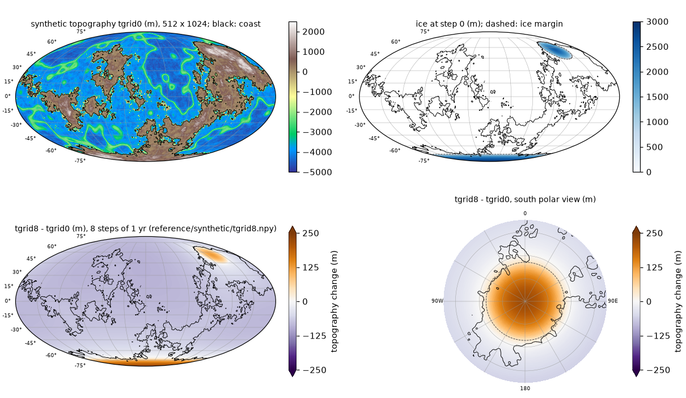

# Verifying the installation

This page lists the checks you can run, which implementation each covers, and what a passing run
prints.

| check | implementation covered | needs | time |
|---|---|---|---|
| [Python tests](#python-tests) `python tests/run_all.py` | Python solver | numpy (ducc0 optional) | about 5 s |
| [Fortran test](#fortran-test) `bash tests/test_fortran_python.sh` | Fortran solver, against the Python solver | Fortran toolchain, numpy | about 30 s |
| [Non-uniform-step Fortran test](#non-uniform-time-steps-times-file) `bash tests/test_fortran_python_vardt.sh` | Fortran solver with a times file (non-uniform and uniform), against the Python solver | Fortran toolchain, numpy | about 2 min |
| [Second-order placement Fortran test](#second-order-load-placement-and-rates) `bash tests/test_fortran_python_ramp.sh` | Fortran solver with `RAMP=1` and `SLEVOLVE_RATES=1` (uniform and non-uniform steps), against the Python solver | Fortran toolchain, numpy | about 3 min |
| [Fortran-only test](#fortran-only-test) `bash tests/test_fortran_synthetic.sh` | Fortran solver and Fortran input generator, against a shipped reference | Fortran toolchain only (no Python) | about 30 s |
| [Benchmark reference check](#benchmark-reference-check) `python tests/check_reference.py` | either solver, on a benchmark case | the benchmark data | 20-40 s per case |

## Python tests

```bash
python tests/run_all.py
```

Nine plain scripts (no pytest), all of the **Python solver**; the four below, the two non-uniform-step tests of [the next section](#non-uniform-time-steps-times-file), `test_ramp.py` ([second-order placement](#second-order-load-placement-and-rates)), `test_j2dot_two_routes.py` ([J2-dot by two routes](#j2-dot-by-two-routes)) and `test_tpw_direction.py` ([direction of polar motion](#direction-of-polar-motion)):

* `test_recursion.py`: synthetic modal spectrum (random decay rates and residues) and a random
  step-wise load history with non-uniform steps; the recursive update of `solver.ExactMemory` is
  compared with the explicit history sum for the six viscous terms (relative error < 1e-12).
* `test_sht_roundtrip.py`: analysis -> synthesis round trip of a band-limited field on the 512 x 1024
  grid at lmax 63 and 511, numpy backend and ducc0 if importable (relative error < 1e-12).
* `test_small_case.py`: idealised polar ice cap (up to 1000 m, 14 degrees radius, grown and melted over
  8 steps of 1 kyr) on a sloping polar continent and a -4000 m ocean, 128 x 256 grid, lmax 63; the
  marine check removes the floating cap margin and the shoreline moves. It compares (a) the plain
  recursive solver, (b) the extrapolated inner start and (c) an explicit full-history evaluation of
  the viscous terms: (a) vs (c) must agree to < 1e-9 m; (a) vs (b) differ by the inner tolerance only.
  It also reports the fixed-point residual obtained by applying the ocean-load update once more to the
  converged iterate (information only: the convergence criterion of the solver, the ratio of Kendall
  et al. (2005) eq. 83, bounds the change of the coefficient sums between iterations, not this
  residual).
* `test_floating_ice.py`: the floating-ice convention on the case of `test_small_case.py`: the plain
  and the optimised solver (with the numba kernels when numba is installed) must agree to < 1e-9 m,
  beta must be 0 exactly on the grounded ice, and the ocean under the floating cap margin must carry
  water load (beta = 1).

**Expected output** (numbers may differ in the last digits on other machines):

```
== test_recursion.py
test_recursion: 60 non-uniform steps (dt 1.9-1948.3 yr), lmax 12, up to 8 modes: max relative error 7.669e-15  (0.02 s)
test_recursion: PASS
== test_sht_roundtrip.py
...
test_sht_roundtrip: PASS
== test_small_case.py
...
test_small_case: (a) recursive vs (c) explicit history: max |diff| 4.547e-13 m (topography and radial displacement, all steps)
test_small_case: (a) plain vs (b) extrapolated start: max |diff| 3.241e-03 m (max |sea-level change| 203.3 m, ratio 1.6e-05; epsilon1 = 1e-05)
...
test_small_case: PASS
== test_extrap_formula.py
...
test_extrap_formula: PASS
== test_small_case_vardt.py
...
test_small_case_vardt: PASS
== test_floating_ice.py
test_floating_ice: inner iterations [4, 4, 5, 8, 6, 6, 5, 6] (optimised [4, 4, 5, 8, 6, 6, 5, 6]); grounded-ice re-guesses / ice analyses redone 36 / 1
test_floating_ice: plain vs optimised+numba solver: max |diff| 0.000e+00 m
test_floating_ice: step 3 (ice maximum): cells with floating ice 256, of which water-loading ocean (beta = 1) 256; beta = 0 exactly on grounded ice: True
...
test_floating_ice: PASS
== test_ramp.py
...
test_ramp: PASS
== test_j2dot_two_routes.py
...
test_j2dot_two_routes: PASS
== test_tpw_direction.py
...
test_tpw_direction: PASS
== 9/9 passed in 6.8 s
```

The difference of 3.3e-3 m between (a) and (b) is expected: the two inner iterations start from
different first guesses and stop when the change between iterations falls below epsilon1 = 1e-5, so
they differ at the level that tolerance allows (a ratio of 1.6e-5 of the signal), not at round-off.

## Non-uniform time steps (times file)

`python tests/run_all.py` also runs two tests of the non-uniform-step mode:

* `tests/test_extrap_formula.py` feeds a known sequence of increments dS_i and step lengths dt_i
  (uniform: 1 yr; non-uniform: 1, 2, 5, 10, 20, 50, 100, 200, 37.5 yr) through the extrapolated
  inner start of both solvers (Python `solver_opt.extrap_guess`; Fortran
  `modal_state_mod::extrap_coeffs`, compiled when gfortran works, otherwise skipped with a message)
  and compares with
  dS0_j = dt_j [Sdot_(j-1) + (Sdot_(j-1) - Sdot_(j-2)) (dt_j + dt_(j-1)) / (dt_(j-1) + dt_(j-2))],
  Sdot_i = dS_i / dt_i, evaluated independently; equal steps must give exactly 2 dS_(j-1) - dS_(j-2).
* `tests/test_small_case_vardt.py` runs the idealised polar ice cap of `test_small_case.py` with the
  steps 1, 2, 5, 10, 20, 50, 100, 200 yr from a times file and compares the recursive solver with an
  explicit full-history sum over the actual times (1e-9 m); it checks that the extrapolated start
  receives (dt_j, dt_(j-1), dt_(j-2)) from step 3 on, and that a uniform times file reproduces the run
  without one exactly.

```
test_extrap_formula: Python extrap_guess vs formula: max relative error 2.216e-16
test_extrap_formula: Fortran extrap_coeffs vs formula: max relative error 2.216e-16
test_extrap_formula: PASS
test_small_case_vardt: (a) recursive vs (c) explicit history: max |diff| 2.842e-14 m (topography and radial displacement, all steps; max |sea-level change| 71.6 m)
test_small_case_vardt: (d) uniform times file vs no times file: max |diff| (a) 0.0 m, (b) 0.0 m
test_small_case_vardt: PASS
```

`bash tests/test_fortran_python_vardt.sh [WORKDIR]` repeats the Fortran-Python comparison of
`test_fortran_python.sh` on the synthetic Earth (512 x 1024, 8 steps) with the steps 1, 2, 5, 10, 20,
50, 100, 200 yr from a times file. Fortran is built with `DT` unset and finds the file at
`INPUT_FILES/others/times`; Python gets `--times`. It also runs both solvers with a uniform times file
(`t_k = k` yr; Fortran through `SLEVOLVE_TIMES=<file>`) and without one. About two minutes.

```
(1) non-uniform steps: tgrid8 max |Fortran - Python| = 7.822e-11 m (max |topography change| 314.1 m; uniform 1-yr run 221.5 m; vardt - uniform run differ by 92.7 m)
(2) uniform times file vs no times file: Fortran max |diff| = 0.0 m, Python = 0.0 m (no times file, Fortran - Python 5.548e-11 m)
(3) Fortran OUTPUT_SLM/times (non-uniform): [0.0, 1.0, 3.0, 8.0, 18.0, 38.0, 88.0, 188.0, 388.0]
test_fortran_python_vardt: PASS
```

`test_recursion.py` sets the non-uniform step lengths through `ExactMemory.set_dt`, the per-step path
the solvers use with a times file, and checks that the decay factors equal exp(-s_k dt / 1000) exactly (zero difference).

## Second-order load placement and rates

`tests/test_ramp.py` (run by `run_all.py`) checks the optional second-order load placement
(`--ramp`) and the analytic rates on the idealised polar ice cap of `test_small_case.py`:

1. the ramp factor phi(x) = (1 - exp(-x)) / x: phi(0) = 1, phi + (1 - phi) = 1, the series and the
   closed form agree at the switch x = 1e-4;
2. the default is unchanged: `ramp=False` with the rates switched on gives exactly the default run;
3. the recursive ramp state against an explicit full-history sum of the ramp kernel
   sum_j dL_j sum_k a_k (1 - phi(s_k dt_j) exp(-s_k (t_n - t_j))), uniform and non-uniform steps
   (< 1e-9 m);
4. the plain and the optimised solver with the ramp (numba kernels and raw ducc0 when installed;
   extrapolated inner start): topography, R and the rates agree;
5. the analytic rates (`ExactMemory.read_rate` and the rotational rates) against a left difference
   over 0.01 yr on a piecewise-linear prescribed load (< 1e-5 relative).

```
test_ramp: (1) ramp factor limits ok
test_ramp: (2) ramp=False with rates vs default run: max |diff| 0.0e+00 m
test_ramp: (3) ramp, recursive vs explicit history: max |diff| 4.55e-13 m (uniform), 4.55e-13 m (steps [1000.0, 500.0, 2000.0, 250.0, 1000.0, 750.0, 1500.0, 500.0]); ramp - step placement up to 27.7 m
test_ramp: (4) ramp, plain vs optimised (numba + raw ducc0): topography/R 5.27e-11 m, rates 1.77e-14 m/yr, m-dot 5.9e-13 relative; extrapolated start 2.27e-03 m (max |sea-level change| 207 m, epsilon1 1e-05)
test_ramp: (5) analytic rate vs left difference (eps 0.01 yr): non-rotational 7.23e-08, m-dot 3.12e-08, rotational sea level 5.78e-07 (relative); extra point changes the response by 2.1e-10
test_ramp: PASS
```

`bash tests/test_fortran_python_ramp.sh [WORKDIR]` (default `./slevolve_fortran_ramp`) builds the
Fortran solver twice on the synthetic Earth (`RAMP=1` into `fortran/build/fortran_ramp/`, the default
into `fortran/build/fortran_test/`), runs both with `SLEVOLVE_RATES=1`, and compares with the Python
solver (`--ramp`, `--save-fields tgrid,dSLdt,dRdt`): the ramp with uniform 1-yr steps, the ramp with
the non-uniform steps of the times-file test, and the default placement with the rates on. It also
checks that switching the rates on leaves `tgrid8` unchanged. About three minutes.

```
(ramp) tgrid8 5.64e-11 m; dSLdt8 2.41e-13 of max 2.915e+01 m/yr; dRdt8 2.61e-13 of max 1.987e+01 m/yr; m-dot 0.0e+00, Lambda-dot 0.0e+00 (relative) ok
(ramp_vardt) tgrid8 8.05e-11 m; dSLdt8 2.58e-13 of max 4.110e-01 m/yr; dRdt8 2.38e-13 of max 4.260e-01 m/yr; m-dot 0.0e+00, Lambda-dot 0.0e+00 (relative) ok
(step) tgrid8 5.55e-11 m; dSLdt8 2.41e-13 of max 2.915e+01 m/yr; dRdt8 2.60e-13 of max 1.987e+01 m/yr; m-dot 0.0e+00, Lambda-dot 0.0e+00 (relative) ok
Fortran default placement: tgrid8 with rates - without rates = 0.0 m; ramp - default placement 0.20 m (max |topography change| 221.5 m)
test_fortran_python_ramp: PASS
```

The `TPWrate` files are text with 9 significant digits, so their Fortran and Python copies are
identical. The ramp changes this 8-yr case by only 0.2 m because the steps (1 yr) are short against
the relaxation times; `test_ramp.py` (1-kyr steps) shows changes of up to 28 m.

## J2-dot by two routes

`tests/test_j2dot_two_routes.py` (run by `run_all.py`, under a second) computes the present-day
\(\dot J_2\) in two independent ways from the analytic rates with `--ramp` and requires both to match
a closed-form value computed outside the solver, and the two to agree with each other:

* route 1 (gravity): \(\dot J_2=-\sqrt5\,(\dot G_{20}-\dot\Lambda_{20}/g)/a\) from `dSLdt + dRdt` and
  \(\dot\Lambda_{20}\) ([Outputs](outputs.md#analytic-rates-optional)), the (2,0) coefficient taken by
  the test's own Gauss-Legendre quadrature;
* route 2 (inertia): \(\dot J_2=-3C\dot m_3/(2Ma^2)\), from the axial Liouville equation
  \(m_3=-\Delta I_{33}/C\) (Mitrovica & Wahr 2011, eq. 15).

The case (32 x 64 grid, lmax 10, rotation on, no marine check, `prem_512.l96C.ump3.lm1`, 12 steps of
1 kyr) is ice-covered land except two ice-free ocean rows at the nodes of P2; the ice changes by a
piecewise-linear h(t) times a zonal, equatorially symmetric, zero-mean pattern P2 + c P4 that vanishes
on the ocean rows, so the ocean load is exactly zero and the load is a degree-2 ice load. The test
reads the degree-2 load and tidal k of the Love-number file with its own parser and evaluates
\(\dot J_2\) in closed form (elastic part plus modal sum for the load; m3 from eq. 15 of Mitrovica &
Wahr (2011); the rotational deformation through the tidal k2). Route 2 contains no rotational
deformation (the axial equation has none in \(\Delta I_{33}\)) and is compared with the load part.
Tolerances (the reasons are in the test header): route 2 1e-8 relative, route 1 5e-5 (the O(dt^2)
error of the ramp placement of the rotational term), route 1 - route 2 at most 1 % of \(\dot J_2\)
(the rotational deformation, 0.49 % here) and equal to the closed-form rotational term to 1e-2.
With the sign of m3 reversed (+1/C, releases up to 723d95f) route 2 has the wrong sign and route 1 is
off by 1 %, so the test fails.

```
test_j2dot_two_routes: known (closed form, k2 of prem_512.l96C.ump3.lm1): J2-dot -8.948533e-11 /yr = load -8.991789e-11 + rotational deformation 4.325603e-13
test_j2dot_two_routes: route 1 (geoid, Lambda removed)  -8.948394e-11 /yr, rel. error 1.6e-05 (tol 5e-05)
test_j2dot_two_routes: route 2 (-3 C m3-dot / 2 M a^2)  -8.991789e-11 /yr, rel. error vs load part 1.7e-09 (tol 1e-08)
test_j2dot_two_routes: route 1 - route 2 = 0.485 % of J2-dot (tol 1 %, fluid-limit ratio 0.43 %); vs closed-form rotational term 3.2e-03 (tol 0.01); max |ocean load| 5.0e-13 m
test_j2dot_two_routes: (0.0 s)
test_j2dot_two_routes: PASS
```

## Direction of polar motion

`tests/test_tpw_direction.py` (run by `run_all.py`, under a second) pins the direction of the
polar-motion records to the physical sign. By Mitrovica & Wahr (2011, eq. 10), \(m_1+i\,m_2\) is
proportional to \(I_{13}+i\,I_{23}\) with \(I_{i3}=-\int\sigma\,x_i x_3\,dA\), so added mass moves the
rotation pole away from itself. An ice cap of 10 degrees radius at 45 N grows on land (32 x 64 grid,
lmax 10, rotation on, `--ramp`, analytic rates, a zonal south-polar ocean, `prem_512.l96C.ump3.lm1`;
a 1-yr step, then six 1-kyr steps), once at 0 E and once at 120 E. For each case the test requires

* after the 1-yr step, (m1, m2) = alpha (1 + k2E) (I13, I23) / (C - A) with I13, I23 from its own
  quadrature of the load (ice and ocean) and the elastic k2 parsed from the Love-number file
  (relative 2e-3; the viscous response within 1 yr, 2.1e-4 measured);
* the TPW direction atan2(m2-dot, m1-dot) of the `TPWrate` record, written and read back, to equal
  the direction of (I13-dot, I23-dot) of the load, 180 E for the cap at 0 E (1e-3 degrees);
* the same direction from the geoid rate, \((\dot m_1,\dot m_2)\propto-(\mathrm{Re}\,\dot N_{21},
  -\mathrm{Im}\,\dot N_{21})\), \(N_{21}=G_{21}-\Lambda_{21}/g\), the (2,1) coefficient of
  `dSLdt + dRdt` taken by the test's own quadrature in the U basis (1e-3 degrees);
* \(\Lambda_{21}\) of the record to equal the quadrature of
  \(\Lambda=\tfrac12[|\omega|^2a^2-(\omega\cdot\mathbf r)^2]\) for the record's m (relative 1e-9).

In releases up to 2ca4705 the inertia products and \(\Lambda_{21}\) both had the wrong sign
([Release notes](release_notes.md)); the fields, \(\dot J_2\), the TPW speed and the round-off
reproduction of the legacy code were unaffected, so none of the other tests could reveal it. There
every check above fails (the direction by 180 degrees, the closed form and \(\Lambda_{21}\) by a
relative 2).

```
test_tpw_direction: case A (cap at 45 N, 0 E): step 1 (1 yr) I13, I23 = -8.0098e+28, 2.9088e+12 kg m^2 (quadrature); m1, m2 = -3.088922e-07, -6.498298e-24, closed form -3.088266e-07, 1.121510e-23, rel. diff 2.1e-04 (tol 0.002) ok
test_tpw_direction: case A: TPW direction atan2(m2-dot, m1-dot) of TPWrate 180.000000 E; (I13-dot, I23-dot) of the load 180.000000 E (expected 180 E) (tol 0.001 deg) ok
test_tpw_direction: case A: direction from the geoid rate -(Re N21-dot, -Im N21-dot) 180.000000 E (tol 0.001 deg) ok
test_tpw_direction: case A: Lambda21 record 1.007975e+01-2.521382e-16j, quadrature of Lambda(omega) 1.007975e+01+1.016380e-13j, rel. diff 1.5e-14 (tol 1e-09) ok
test_tpw_direction: case B (cap at 45 N, 120 E): step 1 (1 yr) I13, I23 = 3.6759e+28, -6.3646e+28 kg m^2 (quadrature); m1, m2 = 1.417599e-07, -2.454482e-07, closed form 1.417298e-07, -2.453960e-07, rel. diff 2.1e-04 (tol 0.002) ok
test_tpw_direction: case B: TPW direction atan2(m2-dot, m1-dot) of TPWrate 300.008995 E; (I13-dot, I23-dot) of the load 300.008994 E (tol 0.001 deg) ok
test_tpw_direction: case B: direction from the geoid rate -(Re N21-dot, -Im N21-dot) 300.008995 E (tol 0.001 deg) ok
test_tpw_direction: case B: Lambda21 record -4.626213e+00-8.009936e+00j, quadrature of Lambda(omega) -4.626213e+00-8.009936e+00j, rel. diff 1.4e-14 (tol 1e-09) ok
test_tpw_direction: (0.0 s)
test_tpw_direction: PASS
```

## Fortran test

```bash
conda activate slevolve-fortran           # the toolchain of Installation
PYTHON=/path/to/envs/slevolve/bin/python bash tests/test_fortran_python.sh [WORKDIR]
```

The **Fortran solver**, checked against the Python solver on the synthetic Earth of the
[Quick start](quickstart.md) at full resolution. The script

1. writes the synthetic case (`tools/make_synthetic_case.py`: 512 x 1024 grid, an Earth-like random
   topography from a fixed seed, a polar and a mid-latitude ice sheet melting over 8 steps of
   1 yr, Earth model `prem_512.l96C.ump3.lm1`; see the [Quick start](quickstart.md#run-it)) into
   `WORKDIR/INPUT_FILES` (default `WORKDIR`: `./slevolve_fortran_test`);
2. builds the Fortran solver with the defaults and no `CASE`, with the synthetic file names and
   `NSTEPS=8`, into `fortran/build/fortran_test/`;
3. runs it (`SLEVOLVE_INNER=extrap`, 4 threads; `THREADS` to change) and the Python solver
   (`run_ais.py --lmax 511 --inner extrap`, with ducc0 and `--opt all` when available) on the same
   inputs;
4. compares the final topography `tgrid8` of the two runs and prints PASS if they agree to 1e-9 m.

`PYTHON` selects the Python interpreter (default `python3`; it needs numpy). **Expected output**:

```
== synthetic case -> /path/to/slevolve_fortran_test/INPUT_FILES
seed 20261013: random topography (reference/synthetic/topography_seed.npy), two Vialov ice sheets
  polar ice sheet: centre -90.0 N 0.0 E, radius 17.0 deg, H0 3000 m
  mid-latitude ice sheet: centre 56.0 N 132.0 E, radius 12.0 deg, H0 2500 m
  step:                 0      1      2      3      4      5      6      7      8
  polar ice (m):     3000   2625   2250   1875   1500   1125    750    375      0
  mid-lat ice (m):   2500   2400   2150   1800   1350    900    500    200      0
wrote /path/to/slevolve_fortran_test/INPUT_FILES: grid 512x1024, land fraction 0.290, 9 ice files synth_ice_0..8, topography others/synth_topo.npy, earthmodel/prem_512.l96C.ump3.lm1
== Fortran build (CASE unset, NSTEPS=8, defaults)
built: /path/to/slevolve/fortran/build/fortran_test/exe (case=none driver=run_from_zero_plus sht=otf ...)
== Fortran run
== Python run
tgrid8: max |Fortran - Python| = 5.548e-11 m (max |topography change| 221.5 m)
test_fortran_python: PASS
```

The two codes run the same inner iterations (5, 5, 6, 6, 5, 5, 5, 5 per step) and agree to round-off
(about 6e-11 m on a signal of 220 m). The Fortran run log ends with the number of grounded-ice
re-guesses and of repeated ice analyses (`== SLEvolve grounded-ice mask: ...`).



The synthetic Earth at 512 x 1024 (top left: topography, black line: coast; top right: ice at step 0,
dashed: ice margin) and the reference result `reference/synthetic/tgrid8.npy` as the topography change
after 8 steps of 1 yr (bottom; colormap PuOr_r with fixed symmetric limits of +-250 m, the 99th
percentile of |change| (219 m) rounded up, arrows on the colour bar for values beyond; brown:
uplift under the melting ice, up to 221 m, mostly elastic after 8 yr; purple: the ocean floor
sinking relative to the rising sea surface). Drawn by
`python tools/plot_reference.py --case synthetic`.

## Fortran-only test

```bash
bash tests/test_fortran_synthetic.sh [WORKDIR]          # default WORKDIR: ./slevolve_fortran_synth
```

For users without Python. The **Fortran solver** and the **Fortran input generator** are checked
against a reference result shipped with the code. The script

1. builds the Fortran solver as the Fortran test does (no `CASE`, `NSTEPS=8`, synthetic file names) into
   `fortran/build/fortran_synth/`, and with the same compiler the generator
   `tools/make_synthetic_case.f90` and the comparison program `tests/npy_maxdiff.f90` (both use the
   shipped `.npy` reader and writer, `fortran/src/npy_io_mod.f90`);
2. writes the synthetic Earth with the Fortran generator into `WORKDIR/INPUT_FILES`. It reads the same
   topography seed as the Python generator (`reference/synthetic/topography_seed.npy`, built once in
   Python and rounded to whole millimetres), computes the same two ice sheets and writes
   identical `.npy` files (values rounded to whole millimetres);
3. runs 8 steps (`SLEVOLVE_INNER=extrap`, 4 threads; `THREADS` to change);
4. compares `tgrid8` with `reference/synthetic/tgrid8.npy` (computed with the Python solver,
   `run_ais.py --lmax 511 --sht ducc --opt all --inner extrap`, 4 threads, Apple M4 Max) and prints
   PASS if max |difference| < 1e-9 m.

The toolchain is taken from the environment as for `fortran/build.sh` (`CONDA_ENV`, `FC`,
`FFTW_PREFIX`, `OPENBLAS_PREFIX`, `BLASLIB`; [Fortran without Python](install.md#fortran-without-python)).
**Expected output**:

```
== Fortran build (CASE unset, NSTEPS=8, defaults)
built: /path/to/slevolve/fortran/build/fortran_synth/exe (case=none driver=run_from_zero_plus sht=otf ...)
== synthetic case (Fortran generator) -> /path/to/slevolve_fortran_synth/INPUT_FILES
seed 20261013: random topography (reference/synthetic/topography_seed.npy), two Vialov ice sheets
...
wrote /path/to/slevolve_fortran_synth/INPUT_FILES: grid 512x1024, land fraction 0.290, 9 ice files synth_ice_0..8, topography others/synth_topo.npy, earthmodel/prem_512.l96C.ump3.lm1
== Fortran run
== compare tgrid8 with reference/synthetic/tgrid8.npy
max |A - B| =  5.548E-11 m (tolerance  1.000E-09 m; max |B|  4900.0 m)
test_fortran_synthetic: PASS
```

On other hardware or BLAS libraries the round-off differs; a difference of up to about 1e-10 m is
still round-off (`max |B|` is the largest absolute value of the reference topography `tgrid8.npy`, not a change). A larger difference while the inner-iteration counts in `RUN_fortran/OUTPUT_SLM/numiter` are still
those listed above for the Fortran test (5, 5, 6, 6, 5, 5, 5, 5) points to a build problem.

## Benchmark reference check

`reference/` holds reference results of the three benchmark cases, computed with the Python solver
(ducc0 backend, `--opt all --inner extrap`, `--lmax 511`, 8 threads, Apple M4 Max).
`tests/check_reference.py` compares a run of either solver with them; it needs the prepared input data
of the case ([Running the benchmark cases](benchmarks.md), which also shows maps of the reference
results).

* `reference/<case>.json`: the area-weighted RMS and max |value| of each stored field, its value at 20
  named sites, the number of inner iterations of every step and, for Cases 2 and 3, the outer misfit
  (area-weighted RMS of T_pred - T_obs) per pass.
* `reference/<case>/*.npy`: the full 512 x 1024 fields (`<f8`):

| Case | Fields | Selected steps |
|---|---|---|
| 1 | `dtopo_k` = topography change since step 0; `dsl_k` = relative sea-level change -(topography change) on the ocean of step k | 1, 100, 550 |
| 2 | `dtopo_k` = topography change since the start of the pass | 1, 600, 1200 |
| 3 | `dtopo_p1_s50`, `dtopo_p5_s50` = topography change at step 50 of passes 1 and 5; `T0_minus_obs` = converged initial topography (pass 5) minus T_obs | 50 |

Check a finished run:

```bash
python tests/check_reference.py --case case1 --dir OUT_case1_py              # Python run
python tests/check_reference.py --case case1 --dir RUN_case1/OUTPUT_SLM      # Fortran run
python tests/check_reference.py --case case3 --dir OUT_case3_py --topo-pres $INPUT3/others/topo_pres
```

or let it run the reference configuration with the **Python solver** first and then compare:

```bash
python tests/check_reference.py --case case1 --run --input $INPUT1 --workdir RUN
```

It prints one line per quantity (max |difference| and area-weighted RMS difference of each full
field, the RMS and max summaries, the worst site, the inner-iteration counts, the outer misfits) and
ends with `check_reference case1: PASS`, or `FAIL` and the quantities that differ (exit status 1).
Reference fields whose files are not in the run directory are reported as `SKIP` and listed at the
end. The Fortran Case 1 example writes only `tgrid0` (the initial topography snapshot) and `tgrid550`, so `dtopo_550` and the iteration counts (from
`OUTPUT_SLM/numiter`) are compared; on the tested machine this gives `dtopo_550` max |diff| 1.2e-7 m and 2852
inner iterations against 2851 (one step one more; a cell at flotation makes the grounded mask
sensitive to round-off), so use `--iter-slack 1`: `check_reference case1: PASS, 5 item(s) skipped`.

**Tolerances.** The default tolerance is 1e-6 m (`--tol`) for every field and summary, and identical
inner-iteration counts (`--iter-slack 0`). A rerun on the same machine reproduces every field exactly.
On other hardware, BLAS libraries or thread counts the round-off differs, a few steps may need one
inner iteration more or less, and the fields then differ within the inner tolerance; use
`--tol 1e-3 --iter-slack 1` there.

**Next:** [Running the benchmark cases](benchmarks.md).
